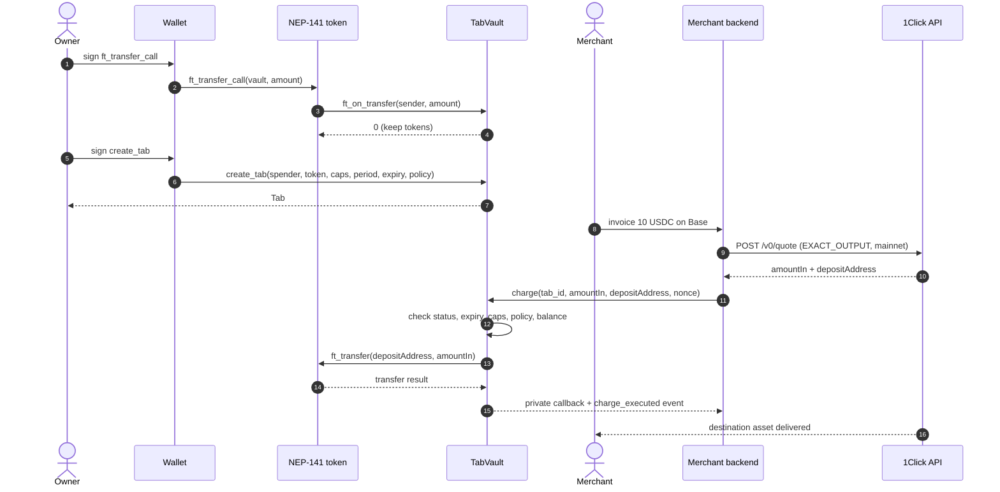

# TabWrit — Contract-Enforced Spending Tabs on NEAR

[](https://testnet.nearblocks.io/address/tab-vault.testnet)
[](docs/evidence/testnet-e2e.json)
[](docs/evidence/meta-tx.json)
[](docs/evidence/agent-x402.json)
[](contracts/tab-vault/src/tests.rs)
[](LICENSE)

> **TabWrit is a contract-enforced spending-Tab layer for merchants and AI
> agents on NEAR. A prompt injection hits the contract, not the wallet.**
> The user funds a personal vault once, then opens capped, expiring, revocable
> Tabs. A merchant or agent holds a scoped key that can charge inside the rule
> and **cannot** withdraw, pause, revoke or change it. Payees receive the asset
> and chain they choose through NEAR Intents (1Click).

**Naming:** **TabWrit** is the project. A **Tab** is the on-chain spending
primitive; a **Writ** is the rule attached to it. The public name can change
without renaming the deployed contracts, accounts or evidence. See
[`docs/NAMING.md`](docs/NAMING.md).

**Live testnet demo:** https://tabwrit.vercel.app  
**Demo video (75s, captioned):** https://x.com/LesnaCrex/status/2118706276091974069

This repository is built for **NEAR Hackathon 2026** (tracks: `security`,
`agents`, `realworld`). The testnet deployment, the Rust tests, the 23-check
Attack Lab, the 12-check gasless suite, the 4-check prompt-injection suite and
the 13-check x402-style agent API suite are real; the cross-chain settlement
path is integrated against the live 1Click API but is **not executed on
testnet** because 1Click is a mainnet service. That boundary is stated
explicitly below.

The hackathon requires a **working prototype** in a public repository and a
public demo post. A mainnet settlement is *not* a requirement; it is optional
future work.

### Hackathon baseline

The public repository was created on 2026-11-01. Its initial commit is the
baseline; later commits are submission changes. The prototype and audit
evidence are dated from 2026-10-19 onward, within the live `HACKATHON.md`
Q-001 eligible-code window.

### Why this is different

- **End-to-end, not agent-only.** The same rule set covers merchant checkout
  and subscriptions as well as x402-style agent payments. Most agent guardrails
  stop at the agent; TabWrit covers both sides of the spend.
- **The spending rule is enforced on-chain, not by a backend.** Caps, expiry,
  allowlist, status and a monotonic nonce are checked by the vault contract.
- **Prompt injection is contained on-chain.** A redirected agent charge is
  rejected with `RECEIVER_NOT_ALLOWED`; no funds move and the nonce is kept.
- **Merchants and agents can charge gaslessly.** NEP-366 lets a scoped key
  sign off-chain; a relayer pays gas and refuses FullAccess-key delegates.
- **The evidence is real.** 23/23 Attack Lab, 12/12 gasless, 13/13 x402 agent
  API, 4/4 prompt-injection, 10/10 browser UI, all with NearBlocks links.
- **A paid API can verify the payment itself.** The x402-style demo binds an
  HTTP 402 invoice to a Tab charge; the API returns data only after it verifies
  the vault's `charge_executed` event. Replay, wrong payer, wrong amount,
  over-cap, redirected receiver and a revoked Tab are rejected.
- **No token and no custody.** Revenue is merchant SaaS plus prepaid relayer
  gas credits; the immutable vault never takes a fee. See
  [`docs/SUSTAINABILITY.md`](docs/SUSTAINABILITY.md).

**Judge quickstart:** [`JUDGE.md`](JUDGE.md) · **Fresh-clone reproduction:**
[`REPRODUCE.md`](REPRODUCE.md).

## Judge proof in 60 seconds

**Try it without a wallet:** https://tabwrit.vercel.app/judge — load Tab #77
and simulate an allowed charge, an over-cap charge, a redirected receiver and
a replayed nonce. The page is read-only; it never signs or sends a transaction.

### The real-world story: Cloudline Monthly

A 10 tUSDC invoice, once a month. The owner funds the vault, opens a 30-day
Tab for `tab-merchant.testnet` with 10/30/120 tUSDC per-charge, per-period and
lifetime caps, and allowlists the merchant. The merchant pulls the invoice
gaslessly with NEP-366; the relayer pays gas. The owner can pause or revoke at
any time, and the unspent vault balance stays withdrawable. This is the
subscription flow in `/merchant`, not a mock.

### Policy is data, not a prompt

A human-readable view of the on-chain Tab fields (example: Tab #77 on testnet):

```json
{
  "owner": "hardjava737.testnet",
  "spender": "tab-merchant.testnet",
  "token": "tab-usdc.testnet",
  "per_charge_cap": "10000000",
  "per_period_cap": "30000000",
  "lifetime_cap": "120000000",
  "period_secs": 2592000,
  "receiver_policy": { "Allowlist": ["tab-merchant.testnet"] }
}
```

The contract stores this policy, checks it before every token call, and gives
the spender a Function-Call key that can only call `charge`. A prompt is not
part of the enforcement path.

### Escape matrix

Every row is a real testnet result or a Rust invariant test; the full reports
are in `docs/evidence/`.

| Attempt | Contract answer | Evidence |
| :--- | :--- | :--- |
| Charge above per-charge cap | `PER_CHARGE_CAP` | S2 |
| Period budget exhausted | `PERIOD_CAP` | S3b |
| Lifetime cap exhausted | `TOTAL_CAP` | Rust fuzz test |
| Receiver outside allowlist | `RECEIVER_NOT_ALLOWED` | S4, A1, M12 |
| Replayed nonce | `ERR_NONCE_MISMATCH` | S11b |
| Expired Tab | `TAB_EXPIRED` | S12 |
| Paused or revoked Tab | `TAB_NOT_ACTIVE` | S5, S13b |
| Unauthorized caller | `ERR_CALLER_NOT_SPENDER` | S7 |
| FullAccess delegate | `KEY_NOT_SCOPED` | M9 |
| x402 receipt replay / wrong payer / wrong amount | `RECEIPT_REPLAY`, `WRONG_PAYER`, `WRONG_AMOUNT` | X3, X5, X6 |
| x402 over-cap / redirected receiver / revoked Tab | `PER_CHARGE_CAP`, `RECEIVER_NOT_ALLOWED`, `TAB_NOT_ACTIVE` | X8b, X7b, X9b |

### One vault, many isolated Tabs

```text
owner vault (shared balance)
  ├─ Tab A — merchant subscription — 10/30/120 tUSDC — allowlist merchant
  └─ Tab B — agent API budget     —  1/5/50 tUSDC  — allowlist API
```

Each Tab has its own caps, nonce and expiry. Revoking one does not touch the
other; both spend from the owner's vault ledger. This is how one owner can run
a merchant relationship and several agents without handing any of them the
vault key.

## Security-first design

TabWrit is designed around one question: **what can a compromised merchant or
agent key do?** The answer must be "spend inside its Tab", not "take the
vault".

| Layer | Control | What it stops | Evidence |
| :--- | :--- | :--- | :--- |
| Contract | Per-charge, period and lifetime caps; expiry; status; receiver allowlist; monotonic nonce; callback rollback | Over-spend, replay, redirected payee, expired/revoked Tab, double accounting | 16 Rust tests + 23/23 Attack Lab |
| Key | NEAR Function-Call key scoped to `tab-vault.testnet::charge`; no deposit; no other method | A leaked key cannot withdraw, pause, revoke, attach a deposit or call another contract | `view_access_key_list` + 12/12 gasless (M9 refuses a FullAccess delegate) |
| Agent | MCP preflight; x402 invoice binding; the paid API verifies the vault's on-chain event | An agent pays the wrong invoice, a replayed receipt or a look-alike event | 13/13 x402 agent API |
| Deployer | Deployer key deleted; the vault has 0 access keys | An upgrade or backdoor by the builder | `view_access_key_list` returns 0 |

The contract is the security boundary. The MCP client and the paid API add
defense in depth, but a bug in either cannot exceed the Tab's on-chain caps or
change its receiver policy.

---

## The problem

1. **Crypto subscriptions lack a pull primitive.** Users either push every
   renewal manually or grant an unlimited token allowance. A compromised
   merchant or wallet drains the whole balance.
2. **Autonomous agents are given raw keys.** A prompt injection or a bug in an
   agent's loop turns into a wallet drain because the key has no spending
   envelope.
3. **Merchants invoice on another chain.** A merchant wants USDC on Base or
   Solana; the user holds USDC on NEAR. Bridging and swapping manually is
   friction the user abandons.

## The idea

TabWrit separates **custody** from **spending authorization**:

- The user deposits NEP-141 tokens into a vault contract and can withdraw the
  unspent balance at any time. There is no admin withdrawal path.
- For each merchant or agent the user opens a **Tab**: a token, a per-charge
  cap, a period budget, a lifetime cap, an expiry and a receiver policy.
- The merchant or agent holds a **Function-Call Access Key scoped to
  `vault.charge`**. NEAR forbids such keys from attaching a deposit and from
  calling any other contract method. A leaked spender key can only charge
  inside the Tab's caps.
- The owner can pause or revoke instantly. Revocation is terminal.
- Every charge consumes a **monotonic nonce**, so a retried transaction cannot
  double-charge.
- **Gasless by construction.** A merchant or AI agent can sign a NEP-366
  `DelegateAction` off-chain with its scoped key; a relayer pays the NEAR gas.
  The relayer only accepts one `charge` call to the vault, signed by a
  Function-Call key scoped to `charge`; a FullAccess key is refused.
- **Prompt-injection containment is on-chain.** If an agent is tricked into
  paying an attacker, a receiver allowlist rejects the charge with
  `RECEIVER_NOT_ALLOWED`. No funds move and the Tab nonce is untouched.
- **Agent job budgets.** A buyer can open a Tab for an agent's job expenses:
  `total_cap` is the expense budget, `per_charge_cap` limits each API call,
  `expires_at_ns` is the job deadline, and the receiver allowlist limits which
  API providers the agent can pay. If the job is cancelled, the owner revokes
  the Tab. This is a use case of the existing contract, not a claim of an
  Agent Market integration.
- For cross-chain settlement, the merchant's backend asks 1Click for an
  `EXACT_OUTPUT` quote and the vault sends the quoted input to the returned
  NEAR deposit address. A solver delivers the destination asset.



On the **testnet demo** the merchant path stops at the NEAR token transfer
(the merchant receives `tUSDC` on NEAR). The 1Click quote preview in
`/merchant` is a live mainnet route; it is not presented as a settlement.

---

## Live testnet deployment

| Item | Address | Explorer |
| :--- | :--- | :--- |
| TabVault | `tab-vault.testnet` | [NearBlocks](https://testnet.nearblocks.io/address/tab-vault.testnet) |
| Test token (tUSDC, 6 decimals) | `tab-usdc.testnet` | [NearBlocks](https://testnet.nearblocks.io/address/tab-usdc.testnet) |
| Merchant / spender | `tab-merchant.testnet` | [NearBlocks](https://testnet.nearblocks.io/address/tab-merchant.testnet) |
| Demo owner | `tab-demo.testnet` | [NearBlocks](https://testnet.nearblocks.io/address/tab-demo.testnet) |
| Agent / spender | `tab-agent.testnet` | [NearBlocks](https://testnet.nearblocks.io/address/tab-agent.testnet) |
| NEP-366 relayer (gas only) | `tab-relayer.testnet` | [NearBlocks](https://testnet.nearblocks.io/address/tab-relayer.testnet) |
| RPC | `https://test.rpc.fastnear.com` | — |
| Hosted web demo | https://tabwrit.vercel.app | [Open](https://tabwrit.vercel.app) |
| Hosted keeper | https://tabwrit-keeper.onrender.com | [Health](https://tabwrit-keeper.onrender.com/health) |

`tab-usdc.testnet` is a **test token**. It has no monetary value. It has a
public `faucet()` that mints 100 tUSDC to the caller so a judge can try the
product without hunting for test assets.

The vault's only full-access deployer key was deleted on 2026-10-24
([78H3E9QC…](https://testnet.nearblocks.io/txns/78H3E9QCqRTs6CXvjXwNYerYVRw8aWgua87rNRwZmJX)).
`view_access_key_list` returns **0 keys**; the contract cannot be upgraded or
replaced by a deployer.

### Verified on-chain evidence

The latest full run is committed in
[`docs/evidence/testnet-e2e.json`](docs/evidence/testnet-e2e.json):
**23/23 checks passed**. Every row is a real transaction with a NearBlocks
link. The same report is rendered at `/lab`.

Selected receipts (full list in the evidence file):

| Check | What it proves | Transaction |
| :--- | :--- | :--- |
| `S1` | A legitimate charge moves exactly the capped amount | [EXJatBga…](https://testnet.nearblocks.io/txns/EXJatBgauSNtSSWu4uyYcFSLX8pUbkgavfJyu3zRky6U) |
| `S2` | A charge above `per_charge_cap` is rejected | [D6yzBN78…](https://testnet.nearblocks.io/txns/D6yzBN78bdo8D45faF8QxSyt19Sd6VAiBKDSmphzrWyk) |
| `S4` | A charge to an unapproved receiver is rejected | [6PGeUFvw…](https://testnet.nearblocks.io/txns/6PGeUFvwhykPpLyC8TyP6MGfTbj2maLtjfGgWjTLedKU) |
| `S10a` | A failed NEP-141 transfer triggers the rollback callback | [E1NJfF4K…](https://testnet.nearblocks.io/txns/E1NJfF4KqBkg1TJSrD4r6a5Esb86YRfvwWGcfSCGeFsq) |
| `S11b` | Reusing a consumed nonce fails | [Dgk3zBDL…](https://testnet.nearblocks.io/txns/Dgk3zBDLJw9rZV25uD9hdHbSxZMNuaAXeXdZVCNCKq4y) |
| `S14` | The owner withdraws unspent funds | [6FQ4Gnhy…](https://testnet.nearblocks.io/txns/6FQ4GnhyJSoyZKR3is81hk1jSQSAf9qZtM2WjNAKTgmb) |
| `M2` | A NEP-366 delegate charges without the merchant paying gas | [J78NCm2F…](https://testnet.nearblocks.io/txns/J78NCm2FpxzyUcNm3gBz1egBbfMH8J3QKosaqA2ithrS) |
| `M10` | An agent charges gaslessly; its NEAR balance is unchanged | [3rNjBBf2…](https://testnet.nearblocks.io/txns/3rNjBBf2G2LZ3CoiQaUgHFpMrhJbczc42nh8bgs8V6Q4) |
| `M12` | The agent's prompt-injected redirect is rejected on-chain | [Dbagm7mB…](https://testnet.nearblocks.io/txns/Dbagm7mBDcTYrDA9L4g271XBDMDig2q6fJedkfjik2zx) |
| `G1` | The browser gasless checkout route settles a 10 tUSDC invoice | [GsZpgNCA…](https://testnet.nearblocks.io/txns/GsZpgNCASb3ojcuhV8nguiuyv3YAFgcC473UrBFLunjC) |
| `A1` | A prompt-injected charge to an attacker is rejected on-chain | [2wKAwrNv…](https://testnet.nearblocks.io/txns/2wKAwrNvPRbWtZREobK6xZxB6iEyYhhaKVMLNgQB9fkx) |
| `H1` | Hosted Vercel + Render keeper settle a real gasless charge | [H51eYJrW…](https://testnet.nearblocks.io/txns/H51eYJrW948N7ksiTVykTvcpPUTRFBc97yBNc5er4NGF) |
| `H2` | Live hosted demo settles a 10 tUSDC gasless charge on Tab #77 | [FGZYsopN…](https://testnet.nearblocks.io/txns/FGZYsopNGBBLy9v4xzki3DD6pDDbGfPgmfC2segpoH6z) |

Hosted smoke report: [`docs/evidence/hosted-smoke.json`](docs/evidence/hosted-smoke.json).

The deployed contract was built from this repository's `contracts/tab-vault`
source with `near-sdk 5.29.1`. The deployer's only full-access key was removed
after the final deployment; `view_access_key_list` returns 0 keys. See
[Security](#security-model) and [`docs/AUDIT.md`](docs/AUDIT.md).

### x402-style agent API evidence

The latest run is in
[`docs/evidence/agent-x402.json`](docs/evidence/agent-x402.json): **13/13
checks passed** against Tab #73. The flow is a real HTTP 402 challenge, a real
Tab charge, and an API that only returns data after verifying the vault's
`charge_executed` event.

| Check | What it proves | Transaction |
| :--- | :--- | :--- |
| `X2` | The MCP tool pays a 0.5 tUSDC invoice and fetches the report | [AnuVqhJk…](https://testnet.nearblocks.io/txns/AnuVqhJkEBhtTshDhs5Vk3WUjxjxMCH62BmJZwj8tPpX) |
| `X7b` | A prompt-injected receiver is rejected with `RECEIVER_NOT_ALLOWED` | [EegUMwMK…](https://testnet.nearblocks.io/txns/EegUMwMK65nRbJK9xtn1PnsoDuRWPX7JSXwLxGrpCit) |
| `X8b` | An over-cap invoice is rejected with `PER_CHARGE_CAP` | [97KDicdX…](https://testnet.nearblocks.io/txns/97KDicdXbprPRrs8X6p3pt4KV18kMV5QKmp5YEms8vYi) |
| `X9b` | A revoked Tab is rejected with `TAB_NOT_ACTIVE` | [HFVjsWsz…](https://testnet.nearblocks.io/txns/HFVjsWszXZuN5hVWePGWf2MRKwLbCPgzM4zrmBKG8Ece) |

The same report also proves receipt replay, invoice replay, wrong payer and
wrong amount rejection. This is an **x402-style** flow with a `tabwrit` payment
scheme, not a full x402 protocol implementation.

---

## Judge walkthrough - "do X → see Y"

For a one-page path, start with [`JUDGE.md`](JUDGE.md). For a fresh clone or a
full testnet deployment, see [`REPRODUCE.md`](REPRODUCE.md).

**No keys or wallet? Start here.** Watch the 75s demo
(https://x.com/LesnaCrex/status/2118706276091974069), open
https://tabwrit.vercel.app/judge for a read-only policy check, open
https://tabwrit.vercel.app/lab, then run `pnpm test`, `pnpm demo` and
`pnpm test:mcp`. These need no `.env` and no author keys. The manual wallet
flow below is optional; steps 6-8 need funded testnet keys.

### Prerequisites

- Node.js 20+ and `pnpm` 9+
- Rust with the `wasm32-unknown-unknown` target:
  `rustup target add wasm32-unknown-unknown`
- On Windows, the Rust host is `x86_64-pc-windows-gnu`; the test wrapper
  auto-detects a WinLibs GCC if one is installed. On Linux/macOS, plain
  `cargo test` is enough.

```bash
pnpm install
```

### 1. Run the real Rust contract tests

**Do X:**
```bash
pnpm test
```

**See Y:** 16 tests pass against the Rust contract in an in-VM environment,
including cap monotonicity, period rollover, pause/resume/revoke, expiry,
insufficient balance, nonce replay, callback rollback, interleaved charges,
conservation of funds and a randomized fuzz test.

```text
running 16 tests
test tests::tests::test_conservation_and_deposit_refund ... ok
test tests::tests::test_interleaved_charge_rollback_preserves_later_charge ... ok
test tests::tests::test_nonce_replay_rejected - should panic ... ok
test fuzz_tests::fuzz::test_fuzz_monotonic_cap_invariants ... ok
test fuzz_tests::fuzz::test_fuzz_conservation_of_funds_under_arbitrary_stress ... ok
...
test result: ok. 16 passed; 0 failed
```

This runs the actual Rust contract in a NEAR VM, not a mocked model.

### 2. Print the last verified testnet Attack Lab

**Do X:**
```bash
pnpm demo
```

**See Y:** the committed 23-row report with real transaction hashes and a
summary:

```text
 TABWRIT - LAST VERIFIED NEAR TESTNET ATTACK LAB
 Network: testnet
 Vault:   tab-vault.testnet
 Token:   tab-usdc.testnet
 ...
 RESULT: 23/23 real on-chain checks passed.
```

This command does not need keys or a network. To **re-run** the transactions:

```bash
# One-time bootstrap. The testnet helper creates and funds the accounts;
# secrets are written only to the gitignored .env.
pnpm testnet:setup

# Re-run the Attack Lab against the freshly deployed contract
pnpm testnet:e2e
```

The runner exits non-zero on any mismatch and rewrites
`docs/evidence/testnet-e2e.json` plus the copy rendered on `/lab`.

For a read-only snapshot of the deployed vault — access-key count, token
metadata, demo/merchant/agent balances, vault ledger and global stats — run:

```bash
pnpm testnet:inspect
```

It uses no key and sends no transaction. The vault must show **0 access
keys**.

### 3. Build and run the web app

**Do X:**
```bash
pnpm --filter web build
pnpm dev:web
```

**See Y:** a production build that type-checks and prerenders the app pages,
then the app at `http://localhost:3005`.

Open `/app`:

1. Connect a NEAR testnet wallet through the HOT Labs connector (Meteor,
   Intear, Nightly, Ledger, etc.). If the wallet needs testnet NEAR for gas,
   use the public faucet at https://near-faucet.io/ or
   https://dev.near.org/faucet. The author-only `pnpm testnet:fund` helper
   needs the demo account key and is not required for judges.
2. If the wallet has 0 tUSDC, click **Get 100 test tUSDC**. This is a real
   `faucet()` call on the test token.
3. Deposit tUSDC with **Deposit** (a real `ft_transfer_call`).
4. Click **Open a Tab**, choose the **Subscription** preset
   (`tab-merchant.testnet` as the spender), and sign `create_tab`.
5. The Tab appears with its caps, remaining allowance, nonce and expiry.

Open `/merchant`:

1. Connect the same owner wallet. The page lists Tabs that authorize
   `tab-merchant.testnet`.
2. Click **Pay 10 tUSDC**. The merchant's server-side Function-Call key calls
   `charge`; the customer does not sign this step.
3. A real NearBlocks transaction and `charge_executed` event are displayed.

If the hosted gasless relayer is cold, uncheck **Gasless**; the direct
merchant charge route still settles the invoice without the keeper. The
Attack Lab, video and `pnpm demo` never depend on the keeper.

The merchant charge key is intentionally server-side and not committed. In
the hosted demo it is set as `MERCHANT_CHARGE_PRIVATE_KEY`; locally, copy
`apps/web/.env.example` to `apps/web/.env.local` and use a scoped testnet key.
Without it, the page shows a clear configuration notice and does not fake a
payment.

The **Cross-chain payout preview** on `/merchant` calls the live 1Click API
for a real mainnet USDC route. It is labeled as quote-only; no funds move.

### 4. Inspect the real Attack Lab UI

**Do X:** open `http://localhost:3005/lab`.

**See Y:** the 23 Attack Lab results, grouped by category, each with its
NearBlocks transaction link, plus the NEP-366, prompt-injection and
x402-style agent API cards. The contract and token addresses and the exact
reproduce commands are on the same page. There is no simulated "PASS" button.

### 5. Verify the MCP server

**Do X:**
```bash
pnpm test:mcp
pnpm test:mcp:charge
```

**See Y:**

- `pnpm test:mcp`: the MCP server starts over stdio, lists **6 tools**, and
  reads live on-chain Tab #1 and its remaining allowance from
  `tab-vault.testnet`. The sixth tool is `tab_pay_and_fetch`, the x402-style
  paid-fetch client.
- `pnpm test:mcp:charge`: the demo owner creates a Tab whose spender is
  `tab-agent.testnet`; the script starts the MCP server and calls
  `tab_charge_invoice` with the agent's scoped key. The agent pays **1 tUSDC**
  to `tab-merchant.testnet`, and the script verifies the Tab counters, the
  vault ledger and the merchant's token balance.
- Last verified agent charge:
  [5CeLAGec…](https://testnet.nearblocks.io/txns/5CeLAGecBQdqqtdXKEEhTzYTEUDuD6tfBuHL7PU9LN1n)
  (Tab #17, nonce 0).

The agent can only charge a Tab that names it as the spender. It cannot
create or revoke Tabs; those remain owner wallet actions.

### 6. Verify the NEP-366 gasless charge (requires funded testnet keys)

Steps 6-8 submit real testnet transactions and need the author's funded
testnet accounts/keys in `.env`. Judges without keys should use `pnpm demo`
and `/lab` instead; the committed evidence contains the same transactions.

**Do X:** start the keeper, then run the direct and web gasless flows:
```bash
pnpm --filter keeper dev
pnpm test:meta
pnpm test:web-gasless
```

**See Y:**

- `pnpm test:meta` → **12/12**. The merchant and the agent each sign a
  `charge` delegate with their scoped key; `tab-relayer.testnet` submits it
  and pays gas. Both NEAR balances are **unchanged**, the relayer's balance
  decreases, and the transaction signer is the relayer. The agent then signs
  a delegate redirecting a charge to `tab-attacker.testnet`; the contract
  rejects it with `RECEIVER_NOT_ALLOWED`, moves no funds and keeps the nonce.
  A replay, a tampered signature and a FullAccess-key delegate are all
  refused.
- `pnpm test:web-gasless` → **3/3**. The browser route
  `/api/merchant/charge-gasless` settles a 10 tUSDC invoice through the same
  relayer and verifies the on-chain counters.
- `pnpm test:relayer-usage` → **5/5**. The keeper's authenticated gas meter
  reports the actual NEAR cost per merchant/agent sender. This is the basis
  for prepaid credits; the vault never takes a fee.
- Evidence: [`docs/evidence/meta-tx.json`](docs/evidence/meta-tx.json),
  [`docs/evidence/web-gasless.json`](docs/evidence/web-gasless.json),
  [`docs/evidence/relayer-usage.json`](docs/evidence/relayer-usage.json).
- Relayer transaction:
  [J78NCm2F…](https://testnet.nearblocks.io/txns/J78NCm2FpxzyUcNm3gBz1egBbfMH8J3QKosaqA2ithrS).

### 7. Reproduce the prompt-injection containment (requires funded testnet keys)

**Do X:**
```bash
pnpm test:agent-attack
```

**See Y:** the script creates a Tab for `tab-agent.testnet` with the merchant
as the only allowlisted receiver, then starts the MCP server and instructs the
agent to pay `tab-attacker.testnet`. The contract rejects the charge with
`RECEIVER_NOT_ALLOWED`, the attacker balance stays zero and the Tab nonce is
not consumed. A second, legitimate invoice to the merchant executes. The run
prints **4/4** and writes
[`docs/evidence/agent-attack.json`](docs/evidence/agent-attack.json).
Rejected transaction:
[2wKAwrNv…](https://testnet.nearblocks.io/txns/2wKAwrNvPRbWtZREobK6xZxB6iEyYhhaKVMLNgQB9fkx).

### 8. Run the x402-style agent API (requires funded testnet keys)

**Do X:**
```bash
pnpm test:x402
```

**See Y:** a local paid API returns a real HTTP 402 challenge with an invoice.
The MCP tool `tab_pay_and_fetch` preflights the Tab, charges **0.5 tUSDC** with
the agent's scoped key, and retries with the on-chain receipt. The API verifies
the vault's `charge_executed` event before returning a live NEAR testnet
report. The script prints **13/13** and proves:

- receipt replay and invoice replay are rejected;
- a wrong payer and a wrong amount are rejected;
- an invoice above the per-charge cap is rejected with `PER_CHARGE_CAP`;
- a prompt-injected receiver is rejected with `RECEIVER_NOT_ALLOWED`;
- a revoked Tab is rejected with `TAB_NOT_ACTIVE`.

Evidence: [`docs/evidence/agent-x402.json`](docs/evidence/agent-x402.json).
Successful payment:
[AnuVqhJk…](https://testnet.nearblocks.io/txns/AnuVqhJkEBhtTshDhs5Vk3WUjxjxMCH62BmJZwj8tPpX).

This is an x402-style flow with a `tabwrit` payment scheme and on-chain receipt
verification, not a full x402 protocol implementation. The API is a demo
server bound to `127.0.0.1`; the MCP client's host allowlist defaults to
localhost and requires HTTPS for a remote paid API.

### 9. Verify the merchant webhook verifier

**Do X:**
```bash
pnpm test:sdk
```

**See Y:** a local HTTP listener receives an HMAC-SHA256 signed webhook, the
verifier accepts it, and tampered bodies, wrong secrets and stale timestamps
are rejected. This is a unit test; it is not a settlement.

### 10. Check the 1Click quote (optional)

With the web app running:

```bash
curl -sS -X POST http://localhost:3005/api/quote \
  -H 'Content-Type: application/json' \
  -d '{"chain":"base","recipient":"0x742d35Cc6634C0532925a3b844Bc454e4438f44e","amount":"10000000"}'
```

**See Y:** a live `EXACT_OUTPUT` quote from `https://1click.chaindefuser.com`,
including `amountIn`, `minAmountIn`, `amountOut`, `timeEstimate` and a
correlation id. The response is marked `quote-only`; the testnet demo does not
send the mainnet deposit.

---

## Architecture

### Contract (`contracts/tab-vault`)

```text
TabVault
├── allowed_tokens: LookupSet<AccountId>
├── token_list: Vec<AccountId>
├── balances: LookupMap<(owner, token), u128>
├── tabs: LookupMap<u64, Tab>
├── owner_tabs / spender_tabs: LookupMap<AccountId, Vector<u64>>
├── next_tab_id: u64
├── total_charges: u64
└── token_volume: LookupMap<AccountId, u128>

Tab
├── owner, spender, token
├── per_charge_cap, per_period_cap, total_cap
├── period_secs, start_ns, expires_at_ns
├── receiver_policy: Any | Allowlist(Vec<AccountId>)
├── status: Active | Paused | Revoked
├── spent_total, period_index, spent_in_period, charge_count
├── next_nonce
└── label
```

Methods:

- `ft_on_transfer(sender_id, amount, msg)` — credits allowlisted NEP-141
  deposits. Unknown tokens are returned in full.
- `create_tab(spender, token, per_charge_cap, per_period_cap, total_cap,
  period_secs, expires_at_ns, receiver_policy, label)` — `#[payable]`,
  requires 0.01 NEAR storage. Enforces `0 < per_charge ≤ period ≤ lifetime`,
  a future expiry, a ≤64-byte label and ≤20 allowlist entries.
- `charge(tab_id, amount, receiver_id, reference, nonce)` — spender-only.
  Validates status, expiry, caps, policy and balance; consumes the exact
  nonce; reserves the amount; calls `ft_transfer`; settles in a private
  callback.
- `pause_tab`, `resume_tab`, `revoke_tab` — owner-only.
- `withdraw(token, amount)` — owner-only, effects before interaction.
- Views: `get_tab`, `get_balance`, `get_remaining`, `get_nonce`,
  `list_tabs_by_owner`, `list_tabs_by_spender`, `get_config`, `get_stats`,
  `is_token_allowed`, `get_token_list`, `get_owner_tab_count`, `version`.

### Why the callback is not a snapshot restore

A naive rollback restores the counters captured before the charge. If a second
charge is reserved while the first transfer is in flight, the first failure
would erase the second charge's accounting. TabWrit instead:

- increments `next_nonce` and the counters before the transfer;
- on failure, subtracts the amount from the **current** counters;
- only rewinds `next_nonce` when the failed charge was the latest reservation;
- leaves the nonce consumed when a later charge exists.

This is covered by
`test_interleaved_charge_rollback_preserves_later_charge`.

### Key hierarchy

| Key | Held by | Permissions |
| :--- | :--- | :--- |
| Owner key | User's wallet | Full account access; signs deposits, Tabs, pause/revoke/withdraw |
| Merchant charge key | Merchant server | Function-Call only: `tab-vault.testnet::charge`, no deposit |
| Agent charge key | Agent / MCP process | Function-Call only: `tab-vault.testnet::charge`, no deposit |
| Storage registrar (optional) | Keeper | Full-access low-balance account for NEP-145 storage of 1Click deposit addresses |
| Relayer key | Keeper | Full access on `tab-relayer.testnet` only. Pays gas for NEP-366 delegates; the keeper refuses any delegate not signed by a Function-Call key scoped to `<vault>::charge` |
| Contract deployer | Deployment operator | Deleted after the final deployment; the contract cannot be upgraded |

The owner key never reaches a server. The merchant page reads the owner's Tabs
with view calls; the merchant's server-side key executes `charge`; the contract
checks that the caller is the Tab's spender.

### NEP-366 gasless charge (testnet)

```text
merchant / agent                         keeper (relayer)
  scoped Function-Call key                 tab-relayer.testnet
  (vault::charge, no NEAR needed)          (FullAccess on its own account)
          │                                          │
          │ 1. sign DelegateAction off-chain         │
          ├─────────────────────────────────────────►│
          │                                          │ 2. validate:
          │                                          │    - one charge call
          │                                          │    - receiver = vault
          │                                          │    - key is FunctionCall
          │                                          │      scoped to charge
          │                                          │    - signature, nonce,
          │                                          │      block window
          │                                          │ 3. submit tx to sender
          │                                          ├──────────────► NEAR
          │                                          │                (relayer pays gas)
          │                                          │                TabVault.charge
          │                                          │◄───────────────┘
          │◄──────────── 4. receipt / event ─────────┤
```

The sender account is the outer transaction's receiver; the runtime executes
the delegate as if the sender had signed the inner `charge` call. The relayer
never holds an owner key and cannot redirect the call: the delegate is bound
to the vault, the `charge` method, the exact arguments and the sender's
Function-Call key permission.

### 1Click settlement path (mainnet)

1. The merchant backend calls `POST /v0/quote` with
   `swapType: EXACT_OUTPUT`, origin `nep141:<mainnet token>`, destination
   asset, destination amount, recipient and a real `refundTo` account.
2. 1Click returns `amountIn`, `minAmountIn`, `depositAddress`, `deadline` and
   a signed quote payload.
3. The keeper verifies the token is listed, checks the Tab's caps and
   `ReceiverPolicy::Any`, registers the fresh deposit address on the origin
   token (NEP-145), and calls `charge` with the scoped key.
4. The vault sends `amountIn` to the deposit address. The keeper submits the
   deposit transaction hash to 1Click and polls `/v0/status`.
5. On `SUCCESS`, a merchant webhook `tab.settlement.succeeded` is emitted.
   The earlier `tab.charge.deposited` event only means the NEAR leg was sent.

The testnet demo stops after step 4 (the merchant receives tUSDC on NEAR).
The quote-only preview is the live mainnet route.

---

## Security model

### Guarantees

1. A charge cannot exceed `min(balance, per_charge_cap, period_remaining,
   lifetime_remaining)`.
2. A charge cannot succeed while paused, revoked or expired.
3. Only the Tab's spender can call `charge`.
4. A fixed allowlist rejects any other receiver.
5. A consumed nonce cannot be reused.
6. A failed token transfer rolls back the ledger and counters without erasing
   later in-flight charges.
7. The contract has no deployer withdrawal path. After the final deployment
   the deployer's full-access key is deleted, so the code is immutable.
8. The owner can withdraw unspent funds at any time.
9. The NEP-366 relayer accepts only one `charge` call to the vault, signed by
   an Ed25519 Function-Call key scoped to `charge`. A FullAccess-key delegate
   is refused before any gas is spent.
10. A prompt-injected charge to a receiver outside the allowlist is rejected
    on-chain with `RECEIVER_NOT_ALLOWED`; no funds move and the Tab nonce is
    not consumed.
11. The x402-style paid API returns data only after a vault-emitted
    `charge_executed` event matches the invoice's Tab, payer, receiver, asset,
    amount and reference. The invoice and receipt are consumed once; replay,
    wrong payer and wrong amount are rejected.

### Trust boundaries and honest limitations

- **Receiver identity vs caps.** With `ReceiverPolicy::Any`, the spender
  chooses the receiver (including a rotating 1Click deposit address) within
  the caps. The contract cannot prove that a deposit address belongs to a
  particular merchant. Use `Allowlist` for fixed NEAR receivers; use `Any`
  for 1Click, accepting that the merchant backend is trusted inside the
  budget. This is a deliberate trade-off, not hidden.
- **1Click is mainnet-only.** The testnet app provides a live quote preview,
  not a settlement. A real cross-chain demo requires a funded mainnet vault.
- **Test token.** `tab-usdc.testnet` is not USDC and has no value. It exists
  so the flow can be reproduced without mainnet funds.
- **Storage.** `create_tab` requires 0.01 NEAR. Revoking does not refund it.
  The vault pays storage for balance entries; a dust-deposit spam is bounded
  by the allowlisted token set but is still a known griefing surface.
- **Key compromise.** A leaked spender key can charge up to the Tab's caps
  until the owner revokes. A leaked owner key is a wallet compromise;
  TabWrit cannot protect against that. The deployer key is deleted after
  deployment.
- **No external audit.** The evidence is 16 Rust tests and the real testnet
  Attack Lab, gasless, prompt-injection and x402 suites. A production
  deployment with meaningful TVL should get an independent audit.
- **x402-style demo, not full x402.** The paid API uses a `tabwrit` scheme, an
  in-memory invoice store and a localhost demo server. The on-chain payment
  verification is real; durable invoices, hosted TLS, authentication, rate
  limits and full x402 compatibility are future work.
- **Optional keeper.** The keeper's 1Click path is mainnet-only and requires
  a separate storage registrar. The testnet demo uses the web app's merchant
  route; the keeper is not on the critical path.
- **Relayer trust and liveness.** The NEP-366 relayer sees the signed delegate
  (Tab ID, amount, receiver) but cannot alter it; the signature binds the
  exact call. It can censor by not submitting. The sender can always submit the
  same delegate itself with gas. The relayer endpoint is authenticated and
  rate-limited. The deployed relayer is testnet-only; a production relayer
  needs a monitored gas balance and the same scoped-key validation.
- **Gasless is not free.** The merchant saves NEAR gas, but the relayer pays
  it. The keeper meters the actual NEAR cost per sender (`GET /relay/usage`);
  a production deployment uses that meter for prepaid gas credits. The demo
  relayer is funded with testnet NEAR only, and no contract fee is taken.

See [`docs/SECURITY.md`](docs/SECURITY.md) for the full threat model and
[`docs/AUDIT.md`](docs/AUDIT.md) for the audit findings and fixes.

---

## Sustainability

The vault is immutable and non-custodial; it transfers the exact charged
amount and has no fee hook. A NEP-366 delegate signed by a Function-Call key
can contain only one `charge` action, so the relayer cannot deduct a fee from
the payment. Revenue therefore lives outside the vault:

- **Merchant SaaS:** invoicing, checkout, webhooks and reconciliation.
- **Prepaid relayer gas credits:** a merchant or agent platform tops up gas;
  the keeper meters the actual NEAR cost per sender. `GET /relay/usage` is
  authenticated and `pnpm test:relayer-usage` verifies it. A production
  deployment compares usage with the prepaid credit before the next relay.
- **Agent platform integration:** MCP + relayer integration and policy
  templates.

No token, no custody, no fee inside the vault, and no solver spread (1Click is
an external service). The testnet gas meter is real; mainnet pricing must be
measured before it is claimed. Details, measured testnet numbers and risks:
[`docs/SUSTAINABILITY.md`](docs/SUSTAINABILITY.md).

---

## Hackathon track fit

| Track | Why it fits |
| :--- | :--- |
| `security` (primary) | Contract-enforced caps, scoped Function-Call keys, monotonic nonces, callback rollback, immutable final deployment, 23-check adversarial testnet evidence, gasless-relayer abuse tests and prompt-injection containment. |
| `agents` | Agent budgets with a scoped charge key, MCP read/charge tools, a real prompt-injection containment test (`RECEIVER_NOT_ALLOWED`), gasless NEP-366 charges through a relayer, and owner-only Tab creation/revocation. |
| `realworld` | Pull-payment subscriptions, merchant invoicing, NEP-141 settlement, gasless NEP-366 checkout, cross-chain payouts through NEAR Intents, wallet-signed owner actions. |

The project deliberately does **not** claim a mainnet cross-chain settlement
in this submission. The live quote and the mainnet-ready keeper path are
implemented; executing them requires a funded mainnet vault and real USDC.

---

## Verification matrix

| Component | Method | Scope | Status | Evidence |
| :--- | :--- | :--- | :--- | :--- |
| Rust contract | `cargo test` via `pnpm test` | 16 tests incl. fuzz, callback concurrency, nonce replay, conservation | **PASS** | [`contracts/tab-vault/src/tests.rs`](contracts/tab-vault/src/tests.rs) |
| Testnet Attack Lab | `pnpm testnet:e2e` | 23 real transactions against `tab-vault.testnet` | **23/23 PASS** | [`docs/evidence/testnet-e2e.json`](docs/evidence/testnet-e2e.json) |
| Live testnet state | `pnpm testnet:inspect` | 0 vault keys, balances, stats | **PASS** | Read-only RPC snapshot |
| Contract build | `pnpm build:contract` | Optimized WASM | **PASS** | `tab_vault.wasm` 171 KB, `nep141_token.wasm` 103 KB |
| Web app | `pnpm --filter web build` | Type check + prerender | **PASS** | `next build` output |
| Wallet flow | Manual + connector types | Connect, faucet, deposit, create, pause, revoke, withdraw | **Testnet** | App + tx links |
| Merchant charge | `/api/merchant/charge` | Scoped merchant key, real tUSDC charge, **after** the deployer key was deleted | **Verified** | [89EZYcFj…](https://testnet.nearblocks.io/txns/89EZYcFjJCdR4HJjp5B3dVqzqRtNUHk5aWKxL9a8VuQj) |
| NEP-366 gasless charge | `pnpm test:meta` | 12/12: merchant + agent gasless execute, both NEAR unchanged, injected redirect rejected, replay/tamper/FullAccess refused | **12/12 PASS** | [`docs/evidence/meta-tx.json`](docs/evidence/meta-tx.json) — [J78NCm2F…](https://testnet.nearblocks.io/txns/J78NCm2FpxzyUcNm3gBz1egBbfMH8J3QKosaqA2ithrS) |
| Web gasless checkout | `pnpm test:web-gasless` | 3/3: browser route, 10 tUSDC settled by relayer | **3/3 PASS** | [`docs/evidence/web-gasless.json`](docs/evidence/web-gasless.json) — [GsZpgNCA…](https://testnet.nearblocks.io/txns/GsZpgNCASb3ojcuhV8nguiuyv3YAFgcC473UrBFLunjC) |
| Prompt-injection containment | `pnpm test:agent-attack` | 4/4: attacker charge rejected, legitimate charge executed | **4/4 PASS** | [`docs/evidence/agent-attack.json`](docs/evidence/agent-attack.json) — [2wKAwrNv…](https://testnet.nearblocks.io/txns/2wKAwrNvPRbWtZREobK6xZxB6iEyYhhaKVMLNgQB9fkx) |
| Relayer gas meter | `pnpm test:relayer-usage` | auth 401/200; actual gas per merchant/agent sender | **5/5 PASS** | [`docs/evidence/relayer-usage.json`](docs/evidence/relayer-usage.json) |
| x402-style agent API | `pnpm test:x402` | 13/13: paid fetch, replay, wrong payer/amount, over-cap, redirect, revoke | **13/13 PASS** | [`docs/evidence/agent-x402.json`](docs/evidence/agent-x402.json) — [AnuVqhJk…](https://testnet.nearblocks.io/txns/AnuVqhJkEBhtTshDhs5Vk3WUjxjxMCH62BmJZwj8tPpX) |
| Fresh-wallet E2E | `pnpm test:tester` | 12 owner-flow checks on a funded test wallet | **12/12 PASS** | [`docs/evidence/tester-wallet-e2e.json`](docs/evidence/tester-wallet-e2e.json) |
| Browser UI E2E | Playwright injected wallet + local test signer | 10/10: connect, deposit, create, pause/resume, withdraw, **gasless** merchant pay, quote, lab | **PASS** | [`docs/evidence/UI_E2E.md`](docs/evidence/UI_E2E.md) — [gasless merchant tx](https://testnet.nearblocks.io/txns/FSsWgW2DX9KYeMM1DH34v1tUaJZMdScQ5S9aVuzw6e7Z) |
| 1Click quote | `/api/quote` | Live mainnet `EXACT_OUTPUT` quote | **Verified** | API response, no funds moved |
| MCP server | `pnpm test:mcp` + `pnpm test:mcp:charge` | 6 tools; live read + real agent charge + x402 paid fetch | **PASS** | Tab #1 read; agent paid 1 tUSDC — [5CeLAGec…](https://testnet.nearblocks.io/txns/5CeLAGecBQdqqtdXKEEhTzYTEUDuD6tfBuHL7PU9LN1n) |
| Webhook verifier | `pnpm test:sdk` | HMAC + tamper/replay unit test | **PASS** | Local listener |
| Optional keeper | `pnpm test:keeper` | health, auth, testnet guard, live quote | **PASS** | `/charge` 501 `MAINNET_REQUIRED`; live quote 200 |
| External audit | Independent review | Not performed | **NOT DONE** | — |

---

## Repository layout

```text
contracts/
  tab-vault/            Rust TabVault (near-sdk 5.29.1)
    src/lib.rs          storage, charge, callback rollback, views
    src/types.rs        Tab, caps, policies, results
    src/events.rs       NEP-297 envelopes
    src/tests.rs        16 real in-VM tests
    src/fuzz_tests.rs   randomized cap + conservation tests
  nep141-token/         Testnet tUSDC with a public faucet
apps/
  web/                  Next.js 14 app (wallet, vault, merchant, lab, judge, docs)
    src/lib/wallet.tsx  HOT Labs wallet connector, wallet-signed calls
    src/lib/server-near.ts  server-only merchant charge (scoped key)
    src/lib/server-meta-tx.ts  NEP-366 delegate signing + relay call
    src/app/api/merchant/charge  authenticated merchant route
    src/app/api/merchant/charge-gasless  browser-facing gasless route
    src/app/api/quote   live 1Click quote preview
    src/data/*.json     copies of the real evidence rendered at /lab
services/
  keeper/               Optional merchant keeper (1Click + webhooks + NEP-366 relayer)
    src/relayer.ts      scoped-key validation and gas payment
    src/usage.ts        per-sender gas meter for prepaid credits
packages/
  tab-mcp/              MCP server: read tools + scoped charge + x402 paid fetch
    src/x402-client.ts  HTTP 402 challenge, Tab preflight, on-chain receipt
  tab-sdk/              HMAC webhook verifier + NEP-366 client helpers
scripts/
  create-testnet-accounts.ts  testnet helper account creation
  create-relayer.ts           gas-only NEP-366 relayer account
  deploy-testnet.ts           token + vault deployment
  setup-spender-key.ts        Function-Call key scoping
  testnet-e2e.ts              real Attack Lab runner
  test-meta-tx.ts             real gasless charge + relayer abuse checks
  test-relayer-usage.ts       per-sender gas meter check
  test-web-gasless.ts         browser gasless checkout check
  test-agent-attack.ts        prompt-injection containment check
  x402-api.ts                 x402-style paid API with on-chain receipt checks
  test-agent-x402.ts          13-check agent API payment + containment test
  build-contracts.mjs         reproducible WASM build + wasm-opt
  run-rust-tests.mjs          cargo test wrapper (WinLibs-aware)
  preflight-release.mjs       read-only secret/build/release preflight
docs/
  ARCHITECTURE.md       data model and flows
  SECURITY.md           threat model and invariants
  AUDIT.md              audit findings and fixes
  DEPLOYMENT.md         web hosting + mainnet boundary
  NAMING.md             TabWrit name, brand hierarchy and availability notes
  SUSTAINABILITY.md     revenue model + measured relayer gas
  VERIFIED_FACTS.md     live docs and API facts with dates
  evidence/             real testnet transaction reports
render.yaml             free Render keeper blueprint
vercel.json             Vercel web build settings
JUDGE.md                one-page judge quickstart
REPRODUCE.md            fresh-clone and full-testnet reproduction
```

---

## Reproduce from zero

```bash
# 1. Install
pnpm install

# 2. Rust tests (real contract)
pnpm test

# 3. Build optimized WASM
pnpm build:contract

# 4. Create testnet accounts, deploy the token + vault, add scoped keys
pnpm testnet:setup

# 5. Run the real 23-check Attack Lab
pnpm testnet:e2e

# 6. Create the gas-only relayer, start the keeper, run the gasless/agent checks
pnpm tsx scripts/create-relayer.ts
pnpm --filter keeper dev        # terminal A
pnpm test:meta                  # terminal B
pnpm test:relayer-usage
pnpm test:agent-attack
pnpm test:x402
# with the web app running: pnpm test:web-gasless

# 7. Print the evidence (no keys/network needed)
pnpm demo

# 8. Web app
pnpm --filter web build
pnpm dev:web
```

`pnpm testnet:setup` uses the NEAR testnet helper to create the accounts
named in `.env`. The example names (`tab-vault.testnet`, `tab-usdc.testnet`,
`tab-merchant.testnet`, `tab-demo.testnet`, `tab-agent.testnet`) are the
author's live demo accounts; for a fresh deployment choose your own names in
`.env` first. It writes private keys only to the gitignored `.env`. The
helper funds the accounts with testnet NEAR.

If an account name already exists but its private key is not in your `.env`,
the script warns instead of pretending it can deploy to it. Use a different
name or import the key. The full fresh-clone and fresh-testnet steps are in
[`REPRODUCE.md`](REPRODUCE.md).

---

## License

MIT. See [`LICENSE`](LICENSE).
